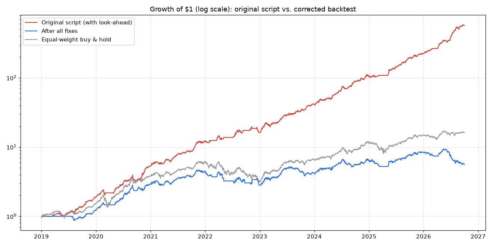

# Case Study: Debugging an AI-Generated Trading Backtest

> *"ChatGPT wrote me a backtest that shows 85% a year with a Sharpe ratio of 4. Before I put money into it, can you check whether it's right?"*

This is a typical request. The client's script ([`original/backtest_from_chatgpt.py`](original/backtest_from_chatgpt.py)) is short and readable, and it runs without errors. It is also wrong in five separate ways. Two of them hide each other.

**Strategy:** hold any of AAPL, AMZN, GOOGL, NVDA, TSLA that closes above its 50-day moving average, skip a stock during its most volatile periods, equal-weight what's left. Daily data, 2019 to 2026. The input is unadjusted prices exported from a broker.

## Result

| Step | Total return | Annual return | Sharpe | Max drawdown |
|:--|--:|--:|--:|--:|
| Original script (as received) | 658.8% | **85.3%** | **4.17** | -19.4% |
| + fix same-bar execution (look-ahead) | 149.3% | 19.3% | 0.72 | -58.1% |
| + fix volatility filter (look-ahead) | 149.8% | 19.4% | 0.75 | -54.0% |
| + use split/dividend-adjusted prices | 237.6% | 30.8% | 1.37 | -46.7% |
| + fix metrics (compounding, √252) | 711.1% | 31.1% | 1.14 | -38.4% |
| + 0.10% trading costs | 463.4% | **25.1%** | **0.96** | **-40.7%** |
| *Benchmark: equal-weight buy & hold* | *1524.6%* | *43.5%* | *1.27* | *-49.8%* |

Rows 1–4 keep the original's summed-return metrics so that each row changes only one thing. The total returns jump at row 5 because that is where compounding is switched on.

**Conclusion for the client:** the 85% a year comes from bugs in the script, not from the strategy. Corrected, the strategy returns 25% a year and has a 41% drawdown. Simply holding the same five stocks did better on return and on Sharpe ratio.



## The bugs

### 1. Same-bar execution: look-ahead bias (the big one)

```python
# original
strategy_returns = (weights * returns).sum(axis=1)
```

`weights` on day *t* uses day *t*'s close, and `returns` on day *t* ends at that same close. So the strategy trades on a price it couldn't yet know: it "buys" a stock on the very day the stock rises above its average and books that day's gain.

```python
# fixed: decide at today's close, hold from tomorrow
weights = weights.shift(1).fillna(0)
```

**Impact:** annual return falls from 85% to 19%, and the Sharpe ratio from 4.17 to 0.72. This one bug accounts for almost all of the fake performance.

### 2. Volatility filter uses the whole sample: look-ahead bias

```python
# original
vol_threshold = volatility.quantile(0.8)   # one number per stock, computed from 2019-2026
```

In 2019 the script already knows which volatility level will count as "high" across the next seven years.

```python
# fixed: only the history available on each day
threshold = volatility.expanding(min_periods=120).quantile(0.8)
```

**Impact:** small for this data set (+0.1% a year). It is still a leak, and on other assets or other thresholds this kind of bug can matter a lot. The test suite catches it either way.

### 3. Unadjusted prices: splits look like crashes

The broker export has raw prices. On the day NVDA split 10-for-1, its price "fell" 90%. On 2020-08-31, AAPL (4:1) and TSLA (5:1) split on the same day.

With bug 1 fixed, **the strategy's four worst days are exactly four split dates**, the worst being -29.8% on 2020-08-31. **Bug 1 was hiding this one:** with look-ahead, the strategy "saw" the split-day drop coming and was already out, so switching to adjusted prices barely changed the original's numbers (85.3% → 83.7% a year).

**Fix:** [`adjust.py`](adjust.py) back-adjusts for splits and cash dividends from a corporate-actions file, the same way Yahoo and CRSP do. The result matches Yahoo's official adjusted close to within 0.00005% for all five stocks (`test_back_adjust_matches_yahoo_adjusted_close`).

### 4. Wrong performance maths

```python
cumulative_returns = strategy_returns.cumsum()                    # adds returns instead of compounding
sharpe_ratio = mean / std * np.sqrt(365)                          # stocks trade ~252 days a year, not 365
max_drawdown = (cumulative - cumulative.cummax()).min()           # difference of sums, not a % of peak equity
```

The √365 factor alone inflates every Sharpe ratio by 20%. Summed returns understate gains in good years and give a meaningless drawdown.

### 5. No trading costs

The strategy rebalances every day. At 0.10% per unit of turnover (commission plus spread), costs take 6% a year off the return.

### Not fixable from the data: hindsight in the stock list

The five stocks are 2026's mega-cap winners, picked with hindsight, so even the buy & hold benchmark looks unrealistically good. A real test would trade the S&P 500 as its membership stood on each date. That needs point-in-time index constituents, which the client didn't provide; the client was advised about it.

## Warning signs to check first

These are what flag a backtest like this within minutes, before any line-by-line reading:

- **A Sharpe ratio above 3 from a daily long-only stock strategy.** Hedge funds would pay a lot for that; a 50-day SMA won't give it.
- **An equity curve that is too smooth** (the red line above). Real trend strategies have long flat or losing stretches.
- **The worst days line up with corporate actions.** Sort the daily returns and look up the dates.
- **The perturbation test:** change prices after date *T*; if any result before *T* changes, the code leaks future data. That is [`test_lookahead`](tests/test_fixes.py), which passes on the fixed code and fails on the original.

## How the fixes are verified

| Test | What it proves |
|---|---|
| `test_original_settings_reproduce_the_original_script_exactly` | Running [`backtest.py`](backtest.py) with every fix switched off reproduces the client's printed numbers, so the bug list is complete and nothing else changed. |
| `test_lookahead[FIXED / ORIGINAL]` | Shocking future prices leaves past results unchanged after the fix, and changes them before it. |
| `test_back_adjust_matches_yahoo_adjusted_close` | The adjustment code matches an independent source. |
| `test_split_days_are_not_losses_after_adjustment` | Split dates are the worst days on raw prices, and are normal days after adjustment. |
| `test_metrics_compound_and_use_trading_days` | Compounding is used, and the Sharpe ratio is annualised with √252. |

## Run it

```bash
python -m venv .venv
.venv\Scripts\activate        # macOS/Linux: source .venv/bin/activate
pip install -r requirements.txt
python original/backtest_from_chatgpt.py   # the client's numbers
python audit.py                            # the table and chart above
pytest -q
```

`data/` is included, so everything runs offline. [`fetch_data.py`](fetch_data.py) shows how it was built: Yahoo prices are converted back to raw broker-style prices, and splits and dividends are saved to a corporate-actions file.
